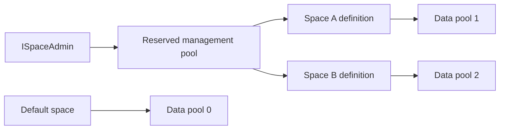

import { CardGrid, LinkCard } from "@astrojs/starlight/components";

A space is an isolated IdentityServer environment within one application deployment. Each space has its own configuration
and operational data, while the application shares the same process, code and database infrastructure.

Use Spaces when you need to host multiple security domains without operating a separate IdentityServer deployment for
each one. Examples include software-as-a-service tenants, regional environments or independently administered business
units.

## How Spaces Isolate Data

Spaces build on the pooled storage model in
[Duende Storage](/identityserver/data/providers/duende-storage/index.mdx). Each space maps to a storage pool, a logical
partition within the same database identified by a numeric pool ID. This isolates all configuration and operational data
for that space. IdentityServer resolves the current space at the start of a request and routes all subsequent store
operations to that pool.

The reserved management pool is separate from every pool that holds IdentityServer data. It stores each space definition,
including its matching rules and assigned data pool. The default space uses data pool `0`, while configured spaces normally
use positive pool IDs. Normal IdentityServer requests never use the management pool as their data pool.



Use `ISpaceAdmin` from a protected administration path to create spaces or change their pool assignments. Moving a space
to another pool changes which data it sees, so authorize and audit these operations as changes to a security boundary.
Reserve pool reassignment and deletion for break-glass or deliberate deprovisioning procedures.

### Space Lifecycle: Delete, Undelete, and Purge

`ISpaceAdmin` manages the end of a space's life, through delete, undelete, and purge operations. Each method returns a
`SaveResult<SpaceId>`. Check its success state instead of assuming the call worked.

1. `DeleteAsync(SpaceId id, CancellationToken ct)` soft deletes the space. Its pool data is blocked from reads and
   writes but retained. The space's match patterns and pool ID stay reserved, so no other space can claim them.
2. `UndeleteAsync(SpaceId id, CancellationToken ct)` restores a deleted space to active, along with its matching
   rules. Calling it on a space that is already active succeeds without changing anything.
3. `PurgeAsync(SpaceId id, CancellationToken ct)` permanently removes the space. It purges all data in the space's
   storage pool and then deletes the space record. A purge can't be undone. It's also the only step that releases the
   space's match patterns and pool ID for reuse.

`PurgeAsync` is only valid for a space that you already deleted with `DeleteAsync`. Otherwise it returns a failed
result and doesn't throw:

| Situation                                      | Failure                                                                  |
|------------------------------------------------|--------------------------------------------------------------------------|
| The space doesn't exist or is already purged   | `not_found`                                                              |
| The space is still active                      | A validation error asking you to call `DeleteAsync` first. No data is removed. |
| The space was modified concurrently            | A version conflict                                                       |

`PurgeAsync` only purges the storage instance that holds Spaces data. If your application keeps data for a pool in a
different storage instance, purge that data yourself before reusing the pool ID.

#### Undelete Failures

`UndeleteAsync` returns a failed result and leaves the space deleted in these cases:

| Error code     | Cause                                                                                                                                                                                                         |
|----------------|---------------------------------------------------------------------------------------------------------------------------------------------------------------------------------------------------------------|
| `eav_conflict` | Another space has claimed a unique extended property value that the deleted space held. You get one error per conflicting value, naming the attribute, the value, and the space that holds it.                |
| `schema_drift` | The current schema no longer has an attribute that the deleted space stored. You get one error per missing attribute.                                                                                        |
| `not_found`    | The space was never created or has already been purged.                                                                                                                                                       |

An undelete never partially restores a space. It either fully succeeds or leaves the space deleted. Because all
conflicts are reported together, you can resolve each one and retry.

Deleting a space releases its unique extended property values so other spaces can claim them. That's why a later
`UndeleteAsync` can fail with `eav_conflict`.

## How Spaces Resolve Incoming Requests

A space can match an incoming request by:

* Origin, such as `https://tenant.example.com`
* Path segment, such as `/acme` under the default `/t` prefix
* Both origin and path

Origin claims take precedence so a path cannot route a request away from a space that owns the host. With the default
prefix, a space whose path is `/acme` receives requests under `/t/acme`. Middleware moves `/t/acme` to `PathBase` before
ASP.NET Core routing, leaving the remaining path for IdentityServer endpoints.

Requests that explicitly use the space path prefix but do not match a space receive `404 Not Found`. By default, other
unmatched requests also receive `404 Not Found`; you can opt into the default space with `FallbackToDefault`.

:::caution
Only enable `FallbackToDefault` when serving an unmatched host or path from the default space is an intentional part of
your isolation model. A strict `404 Not Found` response is safer for multi-tenant deployments.
:::

:::caution[Leave `IssuerUri` unset with Spaces]
Spaces rely on IdentityServer inferring the issuer from each request's origin and path base, which is what gives every
space its own `iss` claim. Leave `IssuerUri` unset so each space has its own issuer. Setting a fixed value makes every
space return the same `issuer`/`iss`, although their data and normal OpenID Connect discovery endpoints remain separate.
See [Multi-Issuer](/identityserver/tokens/issuer.mdx#multi-issuer) for how issuer inference works.
:::

## UI and Application Services

Spaces use the same login, consent, logout and error page implementations. Space resolution runs before ASP.NET Core
routing and path-based resolution moves the matched prefix into `PathBase`. The shared UI routes therefore run within the
resolved space and read that space's configuration and operational stores.

Spaces do not add per-space UI code or branding. To vary UI behavior, inject `ISpaceContextAccessor` into a scoped UI
service, read the resolved `SpaceId` and load your own space-aware settings. Apply the same pattern to custom services that
need space-specific behavior.

Space resolution is independent of the `tenant:` value clients can send in `acr_values`. That value is an untrusted,
client-supplied hint that your login page can use within a space; it never selects a space. See
[Tenant Hints](/identityserver/ui/login/tenants.md#tenant-hints-versus-spaces) for a comparison.

User databases and other application-level services are not made space-aware automatically unless they use the shared
`IStorageFactory`. You must isolate or partition them separately when users, profile data, email delivery or other
dependencies belong to a specific space.

:::note[Duende User Management]
[Duende User Management](/identityserver/identity/user-management/index.mdx) uses the same storage factory as
IdentityServer. When Spaces is enabled, User Management data is routed to the resolved space's pool by default. This
isolates user profiles, authenticators, roles and groups per space.

If users must be shared across spaces, use a deliberately separate user directory architecture rather than the default
[space-aware User Management storage](/identityserver/data/providers/duende-storage/getting-started.md#use-duende-user-management).
:::

## What Spaces Does Not Isolate

:::caution[Spaces Do Not Isolate Every Process-Level Dependency]
Spaces isolate persisted data and, by default, [ASP.NET Core Data Protection](/general/data-protection.md) and keyed
`HybridCache` entries created through `IHybridCacheFactory`. They do not automatically isolate every process-level
dependency. Review signing credentials, external caches, telemetry, rate limits and custom services to decide whether
they also need space-aware configuration.

For example, sharing signing credentials reduces cryptographic separation between spaces. Token validation still checks
the issuer, audience and other constraints, but each space should use deliberately scoped credentials when your security
model requires independent trust boundaries. IdentityServer protects its own signing keys through the unpartitioned
Data Protection provider, so they remain valid across every space even when `PartitionDataProtection` is enabled.
:::

To inject the Spaces cache into an application service, use its service key:

```csharp
// CachedService.cs
using Duende.IdentityServer.Spaces;
using Microsoft.Extensions.Caching.Hybrid;
using Microsoft.Extensions.DependencyInjection;

public sealed class CachedService(
    [FromKeyedServices(SpacesServiceProviderKeys.SpacesCache)] HybridCache cache)
{
}
```

By default, Spaces partitions Data Protection by space: `SpacesOptions.PartitionDataProtection` is `true`, and a
protector obtained from the app's `IDataProtectionProvider` binds to the space resolved at the time you call `Protect`
or `Unprotect`. Data that must be shared across every space, such as IdentityServer's signing keys, uses
`IUnpartitionedDataProtectionSource.GetUnpartitioned()` (or the `GetUnpartitioned()` extension on
`IDataProtectionProvider`/`IDataProtector`) to opt out of partitioning for that specific protector. See
[Data Protection](/general/data-protection.md) for more on how providers and protectors work.

Your administration system must authorize operators for the specific spaces they manage. Never trust a space identifier
supplied by a client without allowing the resolution middleware to validate it against a configured match pattern.

<CardGrid>
  <LinkCard
    href="/identityserver/spaces/getting-started/"
    title="Getting Started"
    description="Configure storage, add space resolution and create an initial space."
  />
  <LinkCard
    href="/identityserver/data/providers/duende-storage/"
    title="Duende Storage"
    description="Understand the storage provider and its preview status."
  />
  <LinkCard
    href="/identityserver/samples/spaces/"
    title="Spaces Samples"
    description="Explore runnable samples for multi-space IdentityServer deployments."
  />
</CardGrid>
